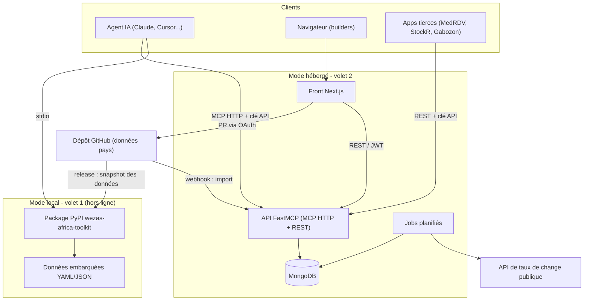
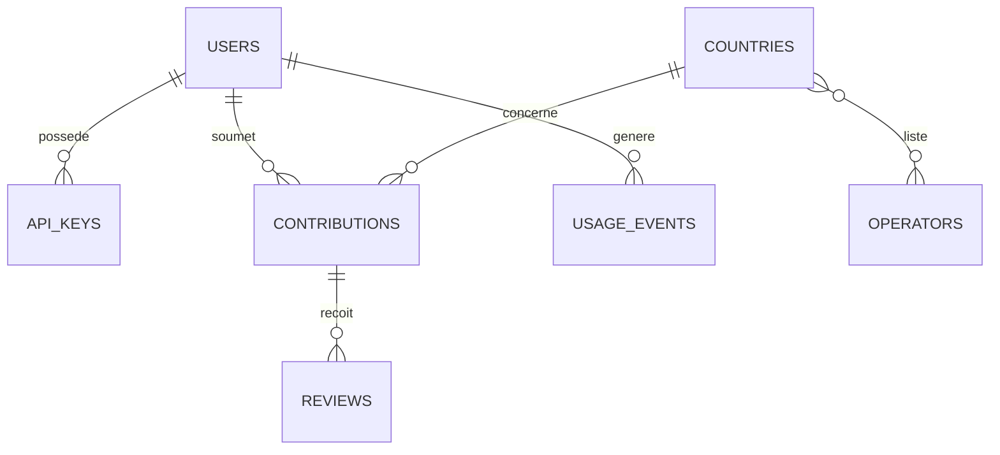
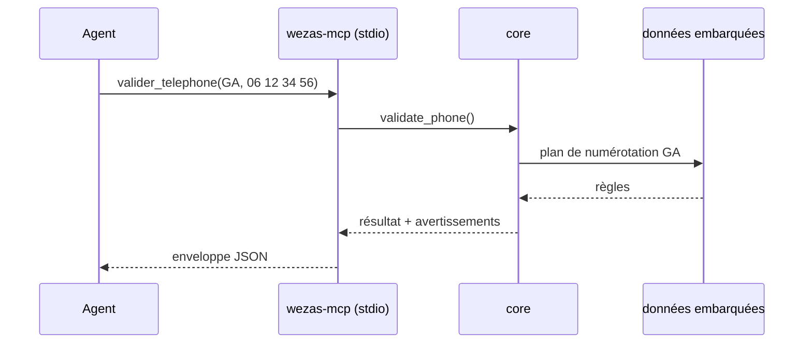
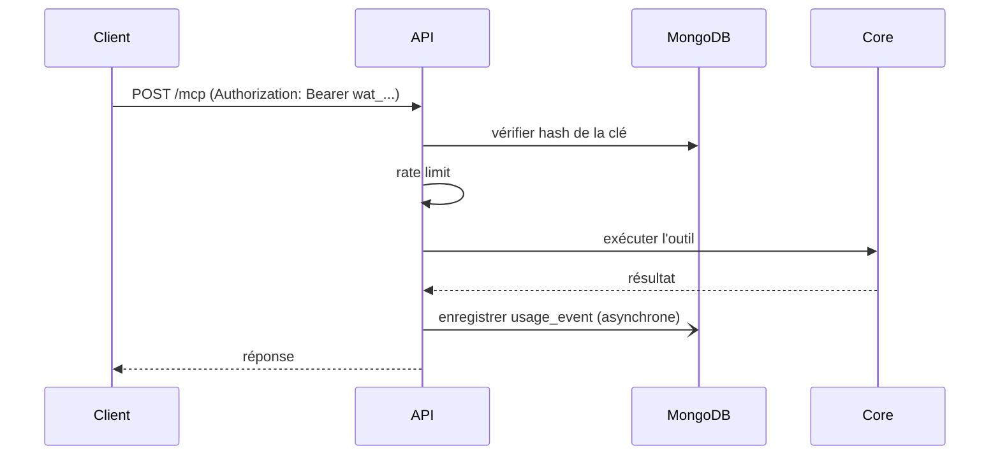
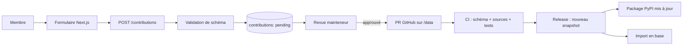
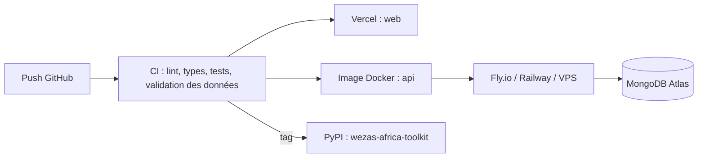

# Wezas Africa Toolkit – Architecture

## 1. Vision

Wezas Africa Toolkit est un serveur MCP pour builders africains, accompagné d'un portail web communautaire.

- **Volet 1 (hors ligne, sans clé)** : `valider_telephone`, `convertir_devise`, `info_pays`. Ces outils tournent en local à partir de données embarquées.
- **Volet 2 (en ligne, optionnel)** : taux de change rafraîchis, contributions communautaires synchronisées, API hébergée.

> [!IMPORTANT]
> **Principe directeur : le volet 1 ne dépend jamais de MongoDB ni du réseau.** MongoDB sert le portail et le volet 2. Les données du volet 1 sont publiées sous forme de fichiers versionnés et embarquées dans le package.

## 2. Stack

| Couche | Technologie | Rôle |
|---|---|---|
| Front | Next.js (App Router, TypeScript), Tailwind, shadcn/ui | Portail, documentation, playground, espace contributeur, admin |
| API / MCP | Python, FastMCP | Serveur MCP (stdio et HTTP streamable) et API REST légère |
| Base de données | MongoDB (Atlas ou auto-hébergé) | Utilisateurs, contributions, clés API, taux, usage |
| Auth | Auth.js (GitHub OAuth) côté front, JWT/clés API côté API | Identification des contributeurs |
| CI/CD | GitHub Actions | Tests, validation des données, publication |
| Hébergement | Vercel (front), Fly.io/Railway/VPS Docker (API), MongoDB Atlas | Déploiement |

## 3. Vue d'ensemble



## 4. Structure du dépôt (monorepo)

```
wezas-toolkit/
├── packages/
│   ├── core/                  # logique pure partagée (sans I/O réseau)
│   │   └── wezas_core/
│   │       ├── phone.py
│   │       ├── currency.py
│   │       ├── country.py
│   │       ├── holidays.py
│   │       ├── models.py      # modèles pydantic
│   │       ├── loader.py      # chargement des données embarquées
│   │       └── data/          # snapshot embarqué (généré depuis /data)
│   ├── mcp-server/            # FastMCP : entrypoints stdio et HTTP
│   │   └── wezas_mcp/
│   │       ├── server.py
│   │       ├── tools/
│   │       └── config.py
│   └── api/                   # volet 2 : REST + MCP HTTP + MongoDB
│       └── wezas_api/
│           ├── main.py
│           ├── routers/
│           ├── services/
│           ├── repositories/  # accès MongoDB (Motor/Beanie)
│           ├── auth/
│           └── jobs/
├── apps/
│   └── web/                   # Next.js
│       ├── app/
│       ├── components/
│       └── lib/
├── data/                      # source de vérité communautaire
│   ├── countries/*.yaml
│   ├── operators.yaml
│   ├── rates.yaml
│   └── schema/*.json
├── docs/
├── scripts/                   # scaffolding, build du snapshot, import
├── tickets.md
├── archi.md
└── docker-compose.yml
```

## 5. Composants

### 5.1 `core` : logique métier pure
- Fonctions déterministes, sans réseau ni base, testées isolément.
- Les 3 outils y sont implémentés : parsing E.164, validation par plan de numérotation, parité fixe XAF/XOF/EUR avec `Decimal`, jours fériés (Pâques calculé, fêtes islamiques par table annuelle).
- Elle est réutilisée à l'identique par le mode local et par l'API hébergée.

### 5.2 `mcp-server` : FastMCP
- **Transports** : `stdio` (local, par défaut) et `streamable-http` (hébergé).
- **Outils exposés** :

| Outil | Entrées | Sortie |
|---|---|---|
| `valider_telephone` | `pays`, `numero` | `valide`, `e164`, `format_national`, `type`, `operateur_probable`, `confiance`, `mobile_money[]` |
| `convertir_devise` | `montant`, `de`, `vers`, `taux?` | `resultat`, `taux_utilise`, `date_taux`, `avertissements[]` |
| `info_pays` | `pays`, `champs?`, `annee?` | `indicatif`, `devise`, `langues`, `fuseaux`, `jours_feries[]` |

- **Enveloppe commune** : `data`, `source`, `derniere_verification`, `confiance`, `avertissements[]`.
- **Mode local** : lit uniquement les données embarquées.
- **Mode hébergé** : même code, avec en plus l'authentification par clé API, la limitation de débit et l'enregistrement de l'usage.
- Les logs vont sur stderr, car stdout est réservé au protocole en stdio.

### 5.3 `api` : services du volet 2
Application FastAPI/ASGI qui monte le serveur FastMCP sur `/mcp` et expose une API REST sur `/api/v1`.

| Route | Description | Auth |
|---|---|---|
| `POST /mcp` | MCP HTTP streamable | clé API |
| `GET /api/v1/countries`, `/countries/{iso2}` | Données pays | publique (limitée) |
| `POST /api/v1/phone/validate` | Validation de numéro | clé API |
| `POST /api/v1/currency/convert` | Conversion | clé API |
| `GET /api/v1/rates` | Taux courants et historique | publique |
| `POST /api/v1/contributions` | Proposer une correction | JWT utilisateur |
| `GET /api/v1/contributions` | Liste, filtres, statuts | JWT |
| `POST /api/v1/contributions/{id}/review` | Valider ou rejeter | JWT mainteneur |
| `GET/POST/DELETE /api/v1/keys` | Gérer ses clés API | JWT |
| `GET /api/v1/usage` | Statistiques d'usage | JWT |
| `GET /health` | Santé | publique |

Les routes REST appellent les mêmes fonctions de `core` que les outils MCP.

### 5.4 `web` : Next.js
- **Pages publiques** : accueil, catalogue des outils, documentation, page par pays, état des taux.
- **Playground** : formulaires pour tester chaque outil en direct. Il peut aussi tourner côté navigateur en s'appuyant sur l'API publique.
- **Espace membre** (OAuth GitHub) : création de clés API, suivi de l'usage, soumission d'une contribution (formulaire guidé qui ouvre une PR ou crée une contribution en base).
- **Admin / mainteneurs** : file de revue des contributions, diff avant/après, publication.
- **Choix techniques** :
  - Server Components par défaut, Route Handlers uniquement pour le BFF.
  - Le front appelle l'API via un client typé généré depuis l'OpenAPI.
  - Contenu documentaire en MDX.
  - Interface FR par défaut, EN en option (`next-intl`).
  - Pensé pour connexions limitées : pages statiques, peu de JS, images optimisées, PWA possible.

### 5.5 Jobs planifiés (dans `api`)
- **Taux de change** : toutes les 6 h, récupération USD/EUR via API publique, écriture dans `rates`, repli sur la dernière valeur connue.
- **Péremption** : alerte si une donnée pays a dépassé sa durée de validité.
- **Synchronisation des données** : import des fichiers `data/` après release.

## 6. Modèle de données MongoDB



### Collections

**`users`**
```json
{
  "_id": "ObjectId",
  "github_id": 123,
  "login": "string",
  "email": "string",
  "role": "member | maintainer | admin",
  "created_at": "date"
}
```
Index : `github_id` (unique).

**`api_keys`**
```json
{
  "_id": "ObjectId",
  "user_id": "ObjectId",
  "name": "string",
  "prefix": "wat_ab12",
  "hash": "sha256 de la clé",
  "scopes": ["tools:read"],
  "rate_limit_per_min": 60,
  "revoked_at": null,
  "last_used_at": "date",
  "created_at": "date"
}
```
Index : `prefix` (unique), `user_id`. La clé en clair n'est affichée qu'une fois et jamais stockée.

**`countries`** (copie en base du snapshot)
```json
{
  "_id": "GA",
  "iso3": "GAB",
  "name": {"fr": "Gabon", "en": "Gabon"},
  "dial_code": "+241",
  "currency": "XAF",
  "languages": ["fr"],
  "timezones": ["Africa/Libreville"],
  "numbering_plan": {"national_length": 9, "ranges": []},
  "holidays": {"fixed": [], "movable": {}},
  "sources": [{"label": "ARCEP", "url": "..."}],
  "last_verified": "date",
  "data_version": "2026.10.1"
}
```

**`operators`** : `_id`, `name`, `countries[]`, `mobile_money[]`, `prefixes{iso2: []}`.

**`rates`** : `pair`, `rate`, `source`, `fetched_at`, `fixed` (booléen pour la parité CFA). Index : `(pair, fetched_at desc)`, avec TTL optionnel sur l'historique.

**`contributions`**
```json
{
  "_id": "ObjectId",
  "user_id": "ObjectId",
  "country": "GA",
  "type": "new_country | fix_range | fix_holiday | other",
  "payload": {},
  "sources": [],
  "status": "pending | approved | rejected | merged",
  "github_pr_url": "string",
  "created_at": "date"
}
```
Index : `(status, created_at)`, `country`.

**`reviews`** : `contribution_id`, `reviewer_id`, `decision`, `comment`, `created_at`.

**`usage_events`** : `key_id`, `tool`, `country`, `status`, `latency_ms`, `ts`. Index TTL de 90 jours, aucune donnée personnelle (jamais le numéro de téléphone saisi).

## 7. Flux principaux

### 7.1 Appel d'un outil en mode local


### 7.2 Appel hébergé avec clé API


### 7.3 Contribution communautaire


> [!NOTE]
> GitHub reste la source de vérité des données. MongoDB sert de file de travail et de cache pour le service hébergé. Les contributeurs à l'aise avec Git peuvent ouvrir directement une PR.

## 8. Sécurité

- **Clés API** : stockées hachées, préfixe identifiable, révocation immédiate, portées (`scopes`).
- **Authentification web** : OAuth GitHub, sessions httpOnly, JWT courts pour l'API.
- **Rôles** : `member`, `maintainer`, `admin`, vérifiés côté API et jamais uniquement côté front.
- **Limitation de débit** : par clé et par IP (Redis ou compteur Mongo en phase initiale).
- **Validation d'entrées** : pydantic partout, taille maximale des payloads.
- **Confidentialité** : les numéros de téléphone soumis ne sont ni journalisés ni stockés.
- **MongoDB** : utilisateur à droits minimaux, TLS, liste d'IP autorisées, sauvegardes quotidiennes.
- **Secrets** : variables d'environnement, jamais dans le dépôt.
- **CORS** : restreint aux origines du portail.
- **Dépendances** : Dependabot, scan de vulnérabilités en CI.

## 9. Observabilité

- Logs JSON structurés avec identifiant de requête.
- Métriques : latence, taux d'erreur par outil, fraîcheur des taux, âge des données pays.
- Endpoint `/health` avec statut MongoDB et dernière mise à jour des taux.
- Alertes : taux périmés, jobs en échec, erreurs 5xx en hausse.

## 10. Déploiement



**Environnements** : `local` (docker-compose avec Mongo), `staging`, `production`.

**Variables d'environnement principales**

| Variable | Composant | Description |
|---|---|---|
| `MONGODB_URI` | api | Connexion MongoDB |
| `JWT_SECRET` | api | Signature des JWT |
| `GITHUB_CLIENT_ID` / `GITHUB_CLIENT_SECRET` | web | OAuth |
| `NEXTAUTH_SECRET` | web | Sessions |
| `NEXT_PUBLIC_API_URL` | web | URL de l'API |
| `RATES_PROVIDER_URL` | api | API de taux (volet 2) |
| `WEZAS_MODE` | mcp-server | `local` ou `hosted` |

## 11. Stratégie de test

| Niveau | Outil | Cible |
|---|---|---|
| Unitaire | pytest | `core` (≥ 90 % de couverture) |
| Données | JSON Schema en CI | Chaque fichier pays |
| Intégration MCP | client MCP stdio | Listing et appels des 3 outils, absence d'accès réseau en mode local |
| API | pytest + `mongomock`/Mongo de test | Routes, auth, rate limit |
| Front | Vitest + Playwright | Pages clés, playground, parcours de contribution |
| Contrat | OpenAPI → client typé | Cohérence front/API |

## 12. Décisions d'architecture

| # | Décision | Raison |
|---|---|---|
| ADR-1 | Logique métier isolée dans `core` | Réutilisée hors ligne et en ligne, testable seule |
| ADR-2 | Données versionnées dans Git, embarquées dans le package | Garantit l'usage hors ligne et sans clé |
| ADR-3 | MongoDB réservé au volet 2 et au portail | Le volet 1 ne doit jamais dépendre d'une base |
| ADR-4 | Un seul code pour stdio et HTTP | Pas de divergence de comportement |
| ADR-5 | Hachage des clés API | Une fuite de base n'expose pas les clés |
| ADR-6 | Pas de stockage des numéros testés | Respect de la vie privée |
| ADR-7 | Taux CFA/EUR fixes, USD daté | Exactitude hors ligne, transparence sur la péremption |

## 13. Correspondance avec les tickets

| Domaine | Tickets existants | À ajouter |
|---|---|---|
| Core et outils | WAT-003 à 027 | Réorganisation en monorepo |
| Qualité | WAT-028 à 031 | Tests API et front |
| Communauté | WAT-032 à 035 | Flux de contribution via le portail |
| Distribution | WAT-036 à 039 | Déploiement du front et de l'API |
| Volet 2 | WAT-043 à 045 | API hébergée, MongoDB, auth, clés, jobs, observabilité |
| Front | | Portail Next.js, playground, espace membre, admin |

> [!TIP]
> Les tickets du portail (Next.js), de l'API hébergée et de MongoDB ne figurent pas encore dans [tickets.md](file:///Users/benjamin/wezas-toolkit/tickets.md). Je peux les ajouter.
